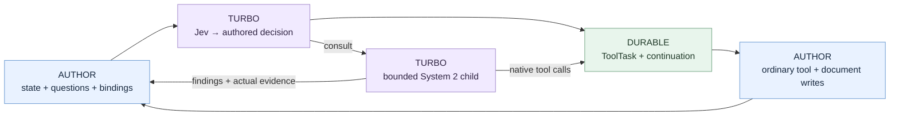

# pi-turbo architecture

Implemented against **Pi Durable 1.2.0**, hosted on **Bun 1.4.3**. Turbo supplies a System 1 decision interface and reusable System 2 consultation. Applications own ordinary Durable tools and documents.

The former coding-agent architecture is available at baseline Git commit `404d6db`. This document describes the current Durable runtime contract. [Before/after comparison](docs/durable-migration.md) · [verification](docs/development.md) · [application example](examples/hyperliquid-news/README.md).

The [Hyperliquid portfolio-monitor foundation](examples/portfolio-monitor/README.md) implements ordinary ingress, portfolio, database, queue and delivery modules plus optional native application tools. Its evaluator remains disconnected: Jev state/questions, turns, Turbo calls and System 2 policy await the user's next design step. The application README distinguishes implemented foundation behavior from deferred evaluation.

Its [shared source core](examples/portfolio-monitor/SOURCES.md) owns connection validation, scheduling, guarded ingress and checkpoint commitment. Inbound integrations install trusted registrations; the core has no Telegram, X or TradingView collector dependency. Provider-specific configuration and message semantics stay with those registrations. The [shared-core map](docs/shared-core.md) defines the common base for the separate source PRs. This extraction does not change Turbo's decision interface or Durable's execution lifecycle.

## Ownership: the agreed scope

| Application author/operator owns | Turbo supplies | Pi Durable supplies |
| --- | --- | --- |
| Goals, state and selected context | Jev integration | Model catalog, credentials and request transforms through `Models` |
| Questions, criteria and action mappings | Decision translation | Native generation and tool execution |
| Product tools and their effects | Consultation and return | Conversations, task ownership and recovery |
| Models, storage, permissions and scheduling | Enforcement of consultation limits | Documents, transactions, storage and task primitives |



Turbo contains no product store, polling scheduler, workflow engine, automatic memory system or replacement tool executor. Removing Turbo leaves valid Durable tools, documents and tasks. Adding another product changes its recipe and application extension.

News relevance and ticket assignment are independent applications. A ticket application would supply its own categories, team IDs, assignment tool and state. It does not run inside the news watcher.

## Public interface

[`createTurbo`](src/extension.ts) accepts one versioned integration, a native classifier reference, ordinary tool references and optional System 2 configuration. It returns a native extension, local provider, model reference and consultation tool.

```ts
// Executable interface shape; product implementations are application code.
const turbo = createTurbo({
  integration: { id, revision, prepareTurn, resolveTurn },
  classifier: { provider: "typesafe", modelId: "jev-latest" },
  tools: [readPortfolio, readNews, sendAlert], // native defineTool() references
  system2: { enabled: true, model: helperModel,
    tools: ["readNews"], maxTurns: 6, maxToolCalls: 8, timeoutMs: 60_000 },
});
registry.install(productExtension);
registry.install(turbo.extension);
models.setProvider(turbo.provider);
// Application opens Harness/storage and selects extensions/tools/model.
```

The tools array declares bindings Turbo may translate and wrap. It does not implement or independently register product tools. The application registers those tools through its Durable extension.

| Interface | Input → output | Required invariant |
| --- | --- | --- |
| `prepareTurn(input, context)` | Native reads + messages + capabilities + latest consultation → `PreparedTurn` or final decision | Select the complete Jev-visible context; return plain JSON data. No application writes. |
| Capabilities | Current native offered tool definitions → authored choices | Respect native enabled tools, model callers, model-tool selection and consultation availability. |
| `PreparedTurn` | `{ request: { state, questions, ... }, bindings }` | Data only. No closures, tool instances or store objects. |
| `resolveTurn(packet, answer)` | Saved packet + validated classifier answer → tool / consult / final | Pure deterministic mapping; exact IDs and arguments come from the saved packet. |
| Tool decision | `{ kind: "tool", name, args }` | Ordinary enabled Durable tool; native validation and permissions still apply. |
| Consult decision | Goal, inputs, completion criterion, exact argument grants or explicit unrestricted arguments | Operator must enable System 2 and include these tools. |
| Final decision | Status + text | Status is recorded as `rawStopReason: "turbo.<status>"`. A settled native submission can still be blocked. |

Bump `integration.revision` when state interpretation, questions, mappings or policy changes. Persisted work rejects an incompatible saved revision. Keep tool registrations/wrappers available until pending tasks settle; do not remove the Turbo extension from a live Turbo conversation. Native registry replacement is application authority, not a sandbox.

## System 1: low-level path

Call path from source; Durable dispatches each task asynchronously.

```text
Conversation.submit(input, requestId)                  DURABLE: admission/deduplication
└─ GenerationTask.request
   ├─ Turbo beforeRequest
   │  ├─ memo: prepared packet + recipe revision       DURABLE task memo
   │  ├─ api.models.classify(authored request)         native model access / Jev
   │  ├─ memo: answer
   │  ├─ author.resolveTurn(packet, answer)            AUTHOR: pure translation
   │  └─ memo: decision + assistant message
   ├─ local provider returns signed prepared message  TURBO: chat-shaped adapter
   └─ native ToolTask                                 DURABLE: schemas/hooks/replay
      ├─ Turbo wrapper checks saved call ID + args
      └─ ordinary application tool executes
         └─ next native generation → prepareTurn
```

The local models are `turbo-<id>/system1` and `turbo-<id>/system2`. A classifier cannot be selected directly as a native chat model. The adapter converts authored decisions into ordinary assistant/tool messages. It does not choose goals or run a tool loop.

The request envelope is signed with a process-local key. Durable reports and skips failed hooks, so the provider must reject missing or altered preparation. Saved responses are re-signed after reopening; signatures are not persisted credentials. This protects the transport from transcript fabrication, not malicious installed code.

The physical classifier identity and usage remain on its assistant response. Invalid answers, invalid JSON, provider errors and oversized inputs stop with a recorded diagnostic. Failed or cancelled inference cannot resolve an action. Turbo does not retry unchanged classifier input or silently ask System 2 to repair it.

## State and context: V1 is author-managed

Jev judges the supplied state and questions. Turbo does not give it hidden cross-call memory. Persistence stores facts; the author still chooses which facts enter each judgment.

| State | Owner and storage | Recovery / context meaning |
| --- | --- | --- |
| Product data | Author `defineDoc` / `defineDocFamily`, native commits | Author selects scope, history, fork rules and migrations. Other application stores are also possible. |
| Conversation history | Durable entries | Native transcript; author chooses what becomes Jev state. |
| In-flight decision | Turbo data in native generation memos | Packet, answer and decision survive pending work. Memos disappear when the task becomes terminal. |
| Helper scope/result | Turbo conversation document | Fixed deadline, grants, task IDs, evidence and result; not product memory. |
| Jev input | Author's prepared packet | Selected evidence only; Turbo never summarizes or selects articles. |

A task memo is a recovery aid, not a permanent evaluation dataset. If an application needs frozen decision cases after completion, it must explicitly retain them in its own documents/entries.

```text
NEWS EXAMPLE — synthetic meaning, not a measured Jev result
A arrives → author sends [A, portfolio] → Jev chooses skip
            application records skip and retains A
B arrives → author sends [A + prior skip, B, portfolio]
            Jev can choose alert / defer / scoped consultation
```

The news recipe matches consultation to its article host-side, then sends Jev the helper goal/completion criterion, status, findings, sources, uncertainties and actual tool evidence. Original inputs, task IDs and model accounting stay in the native handback instead of duplicating the selected article window and portfolio. The `durable-2` recipe revision rejects pending packets prepared with the former representation.

The example retains 48 hours of articles and selects up to 24 preceding/current articles. It labels omitted articles and truncated excerpts. Related evidence outside that authored window is unavailable. Review and receipt ledgers grow until the application archives them deliberately.

If the request exceeds a model limit, the call fails explicitly. The author changes selection and starts another check. Turbo declines native compaction in its conversations. Automatic retrieval, shrinking, summarization, story clustering and learning remain outside V1.

## System 2: reusable consultation, native execution

```text
S1 consult decision, saved on its generation
└─ native consultation ToolTask (replay: safe)
   ├─ save original scope + absolute deadline in native memo
   ├─ find/create conversation owned by this tool task
   └─ child.submit(requestId = consult:<toolTaskId>)
      └─ native GenerationTask loop
         ├─ beforeRequest: check scope/turn ceiling
         ├─ api.models.streamSimple(physical LLM, native messages)
         ├─ memo response → signed local provider transport
         └─ native ToolTask(s)
            ├─ native schema, permissions and application wrappers
            ├─ Turbo execute wrapper: grants/deadline/call budget
            └─ ordinary product tool
      └─ turbo_<id>_finish alone → structured HelpResult
   └─ return native tool result/details to parent
      └─ author prepares next Jev judgment
```

The helper receives its authored brief plus native system sections/tool definitions, not the parent's transcript. By default, it inherits the parent's extensions, including permission hooks. The operator can explicitly choose another extension set. Tool selection is narrowed to the requested, operator-approved ordinary tools and the finish tool.

| Limit or rule | Implemented behavior |
| --- | --- |
| Enabled/model/tool selection | Operator configuration, checked when used and after recovery. No default physical LLM. |
| Exact arguments | Authored grant intersected with operator tool names; rechecked inside execution, including native replay and nested calls. |
| `maxTurns` | Maximum committed helper model turns; checked before another physical request. Defaults to 6. |
| `maxToolCalls` | Distinct admitted product ToolTasks; replay uses the same budget slot. Defaults to 8. Oversized batches are rejected before effects. |
| `timeoutMs` | Absolute persisted wall-clock deadline, defaults to 60 seconds. Reopening does not reset it. |
| Completion | Finish must be the only call in its batch. Plain text becomes `incomplete`; helper completion does not complete the parent. |
| Return | Status, findings, source claims, uncertainties, original request, child ID, actual tool evidence and physical model usage. |
| Cancellation | Native task ownership cancels child work. Tool code must cooperate with its Chord context. Closing the harness preserves unfinished work. |
| Tool controls | Helpers cannot use tool-result handoff/addTools to expand scope or reset budgets. Ordinary non-helper tools retain native behavior. |

A provider call interrupted before its response is memoized may be repeated by recovery. `maxTurns` is not an exact billing cap across crashes. Replayed safe tools may repeat work; application idempotency remains essential. Deadline enforcement also depends on cooperative tool cancellation and a sensible host clock.

`findings`, `sources` and `completed` are model claims. Actual tool evidence is separate. The parent author decides what evidence matters, whether to change product state and what Jev should judge next.

**Current adapter tradeoff:** physical helper inference occurs in `beforeRequest`; its completed response then goes through the local provider. Put Turbo last among generation hooks so preceding native message policies apply. Native tool hooks still run normally. `Models` credentials/transforms apply, but generation-specific stream options and live partial-token streaming are not forwarded to the physical helper. Deferred provider jobs are unsupported and return incomplete. Do not represent this as complete chat-provider feature parity.

## Recovery and effects

| Interruption point | What happens on reopening |
| --- | --- |
| Before packet/answer commit | Native task invokes the unfinished preparation/inference again. Author preparation must be repeatable. |
| After decision memo | Reuse that decision; do not reclassify changed product state for the saved call. |
| During safe tool | Durable replays the same ToolTask; Turbo rechecks binding, revision, current grant and deadline inside `execute`. |
| During unsafe tool | Durable reports interrupted execution; Turbo does not resend the effect. |
| During consultation | Find the same owned conversation and stable submission; keep its original deadline and limits. |
| After external acceptance, before receipt commit | Effect is uncertain. The application reconciles it; SQLite cannot transact with Telegram. |

Native safe replay can skip the original `beforeTool` chain. Replay-sensitive **application** permissions must also live in the tool or a native execution wrapper. Turbo enforces its own constraints there; it cannot retrofit every third-party permission hook.

The news application uses `replay: "unsafe"` for alerts, commits a pending intent before HTTP, and retains unknown delivery until operator reconciliation. Confirmed receipts deduplicate exact effect keys. This is not exactly-once external delivery.

The application opens `openNodeSqliteStorage` from `@earendil-works/pi-durable/storage/sqlite/node`. Bun 1.4.3 implements `node:sqlite`, so Durable owns the SQLite adapter, transaction queue, schema and migrations; Turbo maintains no storage adapter.

Use one process per storage. A supervisor restarts the worker; Durable resumes committed tasks. The SQLite backend's default WAL/NORMAL settings do not establish power-loss guarantees. SIGKILL recovery tests cover process death only.

## Native extension rules and retained defaults

| Durable system | Turbo/application usage |
| --- | --- |
| `defineExtension`, registry | Application installs product and Turbo extensions; conversations select their names. |
| `hook`, `wrapTool` | Public generation/compaction hooks and execution wrappers; no private runtime casts. |
| `defineTool`, schemas, callers, replay | All product tools stay native. Consultation/finish are native model-callable tools. |
| `Models` | Native TypeSafe classifier and configured physical helper provider. Credentials stay with the host. |
| Documents, `commit`, `memo` | Native persistence only; product documents and consultation bookkeeping remain separate. |
| Tasks and ownership | Native helper recovery/cancellation; application watch uses `defineTask`, `sleep` and checkpoints. |
| Usage | Child model usage belongs to the child ledger; never copied into parent tool usage. Incomplete uncommitted requests may lack a final usage receipt. |
| Compaction/retry/parallel execution | Native capabilities remain available to other conversations. Example explicitly disables compaction/retry and selects sequential tools. |

Published 1.2.0 types/source govern implementation; older article snippets use `content` where current tools use `output`.

## Verification and remaining scope

Production paths run against the real Durable Harness, SQLite, native tasks, hooks and tool executor. Tests substitute inference and external HTTP, including the news A → A+B sequence. Separate-process SIGKILL tests exercise saved decisions, safe/unsafe tools and helper recovery. See [development](docs/development.md) for the full validation matrix.

Live Jev relevance, live helper quality, real portfolio/feed access and Telegram delivery remain unverified. Automatic state management and learning from consultations remain outside this version.
