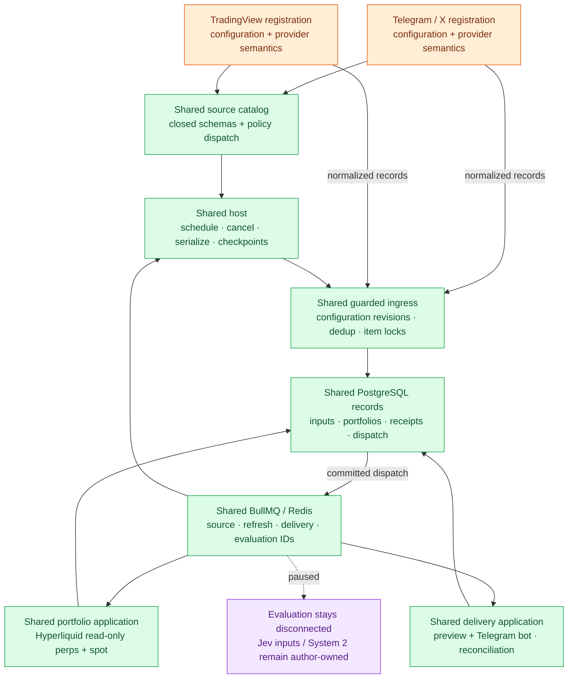

# Shared application core and source PRs

Implemented extraction, 2026-10-17. The common base contains the existing Turbo-on-Durable migration and the portfolio application foundation.
Two source PRs add Telegram/X and TradingView independently. Neither owns another scheduler, database, ingress, queue implementation or evaluator.
Merge the common base first. No PR is merged by this change.

## Ownership

Green is one implementation inherited by both source PRs. Orange is installed provider behavior. Purple is deliberately pending.

## Where the common code lives

| File/module | Why both use it |
| --- | --- |
| `examples/portfolio-monitor/src/sources/catalog.ts` | One closed connection schema drives HTTP and direct storage validation. Unknown providers reject; patches validate the merged resource. |
| `sources/extension.ts`, `contracts.ts` | Small trusted registration and collection interfaces; no inbound SDK imports. |
| `sources/index.ts` | Scheduling lifecycle, cancellation, per-source publication lanes and checkpoint-after-admission rules. |
| `sources/store.ts` | One PostgreSQL implementation of sync admission, backoff, coalescing and startup recovery. Push sources bypass polling. |
| `sources/receiver.ts` | Authenticate provider request, bind enabled source/connection, normalize, then pass exact revisions to storage. |
| `sources/secrets.ts`, `source-cli.ts` | Private credential references and common configuration/status commands. Provider setup contributes commands through registration. |
| `http/` | One authenticated management interface, closed schemas and exact registered webhook route delegation. |
| `storage/`, `queues/` | One application schema and accepted-work protocol; Redis transports IDs. |
| `portfolio/`, `delivery/`, `pi/` | Shared portfolio and delivery features; optional native Durable tools over those same modules. |
| `providers/index.ts` | Explicit application composition; the core list is empty. Each source PR adds registrations here. |

The core is an application module set, not a separately published universal framework. Its source store remains deliberately coupled to the portfolio application's PostgreSQL schema and outbox. Extracting a second database abstraction would add an unused layer.

## Differences beyond HTTP/SDK adapters

| Integration-owned code | Why it cannot be a single universal rule |
| --- | --- |
| Telegram session setup and account lock | Personal MTProto sessions have local login, SQLite and exclusive ownership; bearer-key providers do not. |
| Telegram live identity and revision rules | Mutable usernames must resolve before subscription. Tombstones are terminal; same-second edits stay admissible. The core calls `prepareWatch` and `acceptsRevision` without knowing Telegram. |
| X shared pagination/normalization | Cookie and official API paths share post/edit identity, timeline overlap and scan progress. This is reused within X; it does not describe a Telegram history or headline snapshot. |
| X cookie worker | Rettiwt cancellation requires terminating its worker; another provider's HTTP cancellation does not need that isolation. |
| TradingView coverage semantics | Headline snapshots cannot promise archive catch-up. Missing overlap records a possible gap. |
| TradingView alert event identity | An immutable alert event ID differs from an editable headline or post. Conflicting content for the same event revision rejects. |
| Provider config, target rules, CLI help and fixtures | Account usernames, chat IDs and exchange symbols are different contracts. Rules stay beside the code they validate. |

Outside inbound sources, the Hyperliquid portfolio adapter and Telegram-bot delivery adapter remain separate from source adapters because they implement different product roles. Both source PRs inherit them unchanged. The older `examples/hyperliquid-news` authored evaluator remains separate from this foundation; it owns its own news strategy. The new application's evaluator is not wired to it.

## Composition and integration

Each leaf PR changes its provider folder, provider tests/docs, optional SDK dependencies, and the small `providers/index.ts` composition root.
When combining independently reviewed source PRs, retain all imports/registrations in that file; do not copy shared module changes between PRs.
The combined application uses one catalog and one set of workers. Installed source IDs are unique. No runtime code upload or implicit provider discovery is added.

The shared base uses only application dependencies: Bun/TypeScript, Fastify/TypeBox, PostgreSQL/Bun.SQL/Drizzle, Redis/BullMQ, Hyperliquid SDK, decimal.js, grammY, and Pi Durable.
The social PR adds mtcute, XDK and Rettiwt. TradingView adds no package dependency.

## Verification

Core-only validation on Bun 1.4.3: strict check/build, 67 application unit tests, 11 PostgreSQL/Redis integration tests, and 56 root Turbo/Durable tests passed. The source-level extraction review found no actionable issues. The per-provider and combined matrix is recorded in the PR descriptions after the final branch checks. Core and each leaf branch must independently type-check, build, and pass unit plus PostgreSQL/Redis integration tests.
The combined registration catalog is also checked. Root tests exercise the unchanged Turbo/Durable implementation using substituted model/external transports.
Live provider accounts, sustained collection and relevance/model quality are not established by these tests.
