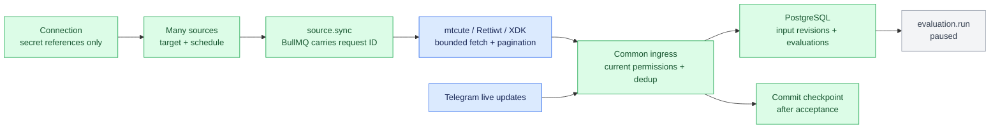

This integration builds on the [shared application core](../../docs/shared-core.md). Telegram/X registration and SDK code lives under `src/providers/`.

# Telegram and X sources

This is executable application code in the portfolio-monitor example. Collection feeds the existing ingress and paused evaluation queue. It does not call Jev, construct prompts or infer portfolio alerts. Use one application process per database/queue namespace. It is a local operator application, not a hosted multi-user credential vault.

## Setup

Install Bun 1.4.3, then from this directory:

```sh
bun install --frozen-lockfile --ignore-scripts
bun run setup
bun run sources --help
```

The CLI uses the same `.env` as the server. `APP_URL` defaults to `http://127.0.0.1:8787`. Configuration commands need the running application and `API_TOKEN`; credential import and Telegram login work before the server starts. A frontend is not required.

## Telegram personal-account input

1. Obtain your own `api_id` and `api_hash` from [Telegram](https://core.telegram.org/api/obtaining_api_id). Put `TELEGRAM_API_ID` and `TELEGRAM_API_HASH` in the private `.env`. These are application credentials, not a bot token.
2. With the application stopped, run the following and answer the local phone/code/2FA prompts. Codes and passwords are not printed or persisted by the CLI.

```sh
bun run sources telegram login --session personal
bun run local
```

In a second terminal in this directory:

```sh
bun run sources connection add --adapter telegram-user --name Personal --session personal
bun run sources connection probe CONNECTION_ID
bun run sources connection targets CONNECTION_ID --limit 100
bun run sources source add --connection CONNECTION_ID --target=-1001234567890 --name "My channel" --interval 60
```

Replace IDs with the returned IDs. Public `@usernames` also work; use discovered IDs for private groups. Discovery lists accessible channels/groups, up to the requested limit (maximum 1,000). You can configure additional known targets directly. Each target is an independent source and may share the same connection. Source listing is paginated; use the returned `nextCursor` with `--cursor`.

The library reuses a private MTProto session under `.source-data/telegram/personal/`. Login/logout and the application cannot concurrently own the same session. On revocation, stop the application, log in again, restart, then explicitly sync a source. To revoke this local authorization:

```sh
bun run sources telegram logout --session personal
```

The adapter reads selected accessible chats without inviting a bot, joining chats, sending replies or marking history as read. Live new/edit/delete events and periodic history reconciliation share one client per connection. The first successful collection pins the numeric chat identity before live subscriptions attach; a changed username cannot silently redirect the subscription. History and live publication are serialized per source, with stale Telegram edits and resurrection after deletion rejected at ingress. It does not `openChat` for every target. Text and captions are collected; attachments, OCR, secret chats and transcription are outside this version. Historical polling cannot establish that an absent message was deleted; deletion revisions require observed channel deletion events. Ordinary group deletion events without a chat identity are omitted. Older edits outside the reconciliation overlap are not guaranteed to be discovered.

Outbound Telegram notifications still use the separate existing bot-token destination adapter. Personal-account source credentials are never used to send notifications.

## X using your session cookies

Prepare a local file containing your X `auth_token`, `ct0` and `twid` as JSON, an exported cookie array, or a Cookie header. Supply it locally; do not put credentials in chat or shell arguments.

```sh
bun run sources credential import --file /private/path/x-cookies.json --name x-personal
```

The command copies the content to a private file and prints only its path. Add the returned reference to `.env`:

```dotenv
X_SESSION=file:/absolute/path/printed/by/the/command
```

Restart the application after `.env` changes, then:

```sh
bun run sources connection add --adapter x-session --name "My X session" --secret-ref X_SESSION
bun run sources connection probe CONNECTION_ID
bun run sources source add --connection CONNECTION_ID --target @ACCOUNT --name "X account" --interval 120
```

`rettiwt-api` uses private X endpoints; its encoded session key is not an official API key or encryption. This adapter is experimental. [X's automation rules](https://help.x.com/en/rules-and-policies/x-automation) prohibit non-API automation and warn of suspension. Endpoint drift, challenges and expired sessions can stop collection. The adapter does not rotate accounts or fall back to an unauthenticated, potentially nonchronological feed. It reports errors rather than interpreting malformed responses as no news.

The stock Rettiwt client runs in an isolated Bun worker, terminated on timeout/cancellation, including its internal transaction-header bootstrap. It only exposes read operations through this application. A fresh worker currently bootstraps each SDK operation, adding requests and latency. X edit reconciliation overlaps two old pages; absence from a timeline is not treated as deletion. Partial/error responses and unknown tweet structures fail the collection without advancing its checkpoint.

## X official paid API

Use a bearer token from your X developer application with access to the required endpoints. Import it with the same credential command, set `X_API_TOKEN=file:/...` in `.env`, and restart. Then:

```sh
bun run sources connection add --adapter x-api --name "Official X" --secret-ref X_API_TOKEN
bun run sources connection probe CONNECTION_ID
bun run sources source add --connection CONNECTION_ID --target @ACCOUNT --name "Official account feed" --interval 120
```

The adapter uses X's [`@xdevplatform/xdk`](https://docs.x.com/xdks/typescript/overview) and public account timelines. Browser cookies do not work in this adapter. This version does not implement a hosted OAuth consent flow or personal home-feed import. Paid live access is unverified without a funded account; fixtures exercise SDK request construction and parsing, not account entitlement or billing.

## Configure, inspect and connect a portfolio

```sh
bun run sources source list
bun run sources source status SOURCE_ID
bun run sources source sync SOURCE_ID
bun run sources source inputs SOURCE_ID
bun run sources source update SOURCE_ID --interval 180 --max-pages 10
bun run sources source disable SOURCE_ID
bun run sources connection disable CONNECTION_ID
```

Source creation starts from its creation timestamp by default. `--since 2026-10-16T00:00:00Z` opts into historical collection. `--max-pages` bounds each fetch (1–20); unfinished pagination retains its cursor and reports `gap:true` until collection reaches the checkpoint boundary. X defaults include replies/reposts; use `--exclude-replies` / `--exclude-reposts` at source creation to filter them. Collection budgets and upstream history limits can leave explicit coverage gaps; this is not a complete archive promise.

Target, connection and initial start time are immutable source identity. Create a new source to change them. Frequency and page budgets can change. All sources are enumerated through pagination; there is no fixed 100-source scheduler or monitor-membership cap. Provider limits and the host's capacity still constrain effective frequency.

Add the returned source IDs to a monitor's `sourceIds` using the existing `POST/PATCH /v1/monitors` API. That monitor binds the sources to its `portfolioId` and `destinationIds`. Accepted new content queues evaluation for the bound portfolio. Duplicate content does not queue a second evaluation. **The evaluator remains disconnected**, so receiving data does not automatically send portfolio alerts.

For credential rotation, import under a new name, add a new environment reference, restart, then run `connection update CONNECTION_ID --secret-ref NEW_REF`. Re-enabling a connection increments its configuration revision. Explicit `source sync` retries repaired authentication but respects a provider's outstanding rate-limit delay.

## Interface and ownership



| Interface | Purpose |
| --- | --- |
| `POST/GET/PATCH /v1/connections[/:id]` | Configuration references and enable/disable |
| `POST /v1/connections/:id/probe` | Verify authentication through a provider read |
| `GET /v1/connections/:id/targets?limit=100` | Telegram channel/group discovery |
| `POST/PATCH /v1/sources[/:id]` | Configure `{name,kind:"adapter",enabled,watch:{connectionId,target,pollIntervalMs,startAt?,maxPages?,includeReplies?,includeReposts?}}` |
| `POST /v1/sources/:id/sync` | Coalesced collection request, HTTP 202 |
| `GET /v1/source-syncs/:id` | Request completion/failure |
| `GET /v1/sources/:id/status` | Checkpoint, last success/error/count, next run and gap |
| `GET /v1/inputs?sourceId=...` | Actual stored input revisions |

The application uses existing PostgreSQL transactions, BullMQ, Fastify/TypeBox and the ordinary ingress. No Pi provider, Turbo recipe, System 2 configuration or conversation is introduced. SDKs own platform protocol details. Telegram MCP projects supplied an authentication/synchronization precedent, not a runtime dependency; Hermes' bot gateway and Grok search do not supply this personal-account raw-feed interface.

| Reused machinery | Why this choice |
| --- | --- |
| [`@mtcute/bun` 0.32.5](https://github.com/mtcute/mtcute) | Personal MTProto accounts, typed messages, updates and SQLite sessions. Its Bun support is described as experimental upstream; pinning and local SDK tests reduce integration uncertainty but do not establish sustained live reliability. |
| [`rettiwt-api` 7.1.4](https://github.com/Rishikant181/Rettiwt-API) | Reuses cookie authentication, request factories, transaction generation and tweet parsing. Application code adds cancellation and rejects incomplete data. Private endpoint compatibility remains experimental. |
| [`@xdevplatform/xdk` 0.6.6](https://docs.x.com/xdks/typescript/overview) | Official TypeScript client for the paid public-timeline path. Account entitlement is independent of SDK compatibility. |
| [`telegram-mcp`](https://github.com/newink/telegram-mcp) | Reference for personal-account mtcute authentication. No MCP server is required between our source worker and the same client library. |
| Existing Hermes Telegram/X tools | Inspected for reuse: the Telegram gateway requires a bot token; X search produces model-assisted research. Neither supplies this personal-account raw-feed interface, so neither is a runtime dependency. |
| Existing application modules | BullMQ scheduling/dispatch, PostgreSQL ingress and input revisions, Fastify APIs and the paused evaluation queue are extended in place. |

## Verification boundary

Verified 2026-10-16 on Bun 1.4.3: strict TypeScript check/build, **87 unit tests** and **seven PostgreSQL/Redis integration tests**, all passing. Compiled source CLI loading and compiled X worker loading/cancellation were also checked. Independent review found and resolved publication races, stranded queue requests, MTProto cancellation hangs, mutable target identity and partial X response handling.

| Production path exercised | Evidence |
| --- | --- |
| Telegram client/session | Actual mtcute SQLite initialization and reopen; SDK message normalization; simulated login callbacks, flood/auth errors, live events, blocked RPC cancellation and transport replacement |
| X session client | Stock Rettiwt in the production worker; fixture homepage/JS bootstrap, transaction-ID generation, authenticated SDK HTTP requests/parsers, malformed/partial responses and cancellation |
| Official X API | Stock XDK request construction and parsing against HTTP fixtures; bearer authentication, pagination, entitlement errors and rate-limit handling |
| Application plumbing | Authenticated HTTP → BullMQ source worker → PostgreSQL input revisions → paused evaluation; duplicate suppression, disable guards, checkpoint commit, history/live races and queued-request recovery |
| Operator setup | Private credential import/resolution, redaction and CLI requests through actual HTTP validation |

Automated tests substitute external provider HTTP/account traffic while exercising actual SDK parsers/request construction and application paths. PostgreSQL/Redis integration uses isolated databases/queues. Live login, accessible targets, actual X endpoint availability, paid API entitlement and sustained collection must be verified using locally supplied credentials. No claim of those follows from a passing fixture test.
