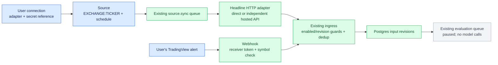

This integration builds on the [shared application core](../../docs/shared-core.md). Its registration and receiver live under `src/providers/tradingview/`.

# TradingView sources

Executable TypeScript application adapters in this example, using the same connection records, local secret resolver, source lifecycle and ingress as Telegram/X. No new queue, database, SDK dependency or Turbo model behavior is added. Each operator configures their own access. This is a local operator application; separate operators need separate deployments/data directories, not shared account credentials.



| Connection adapter | User supplies | Implemented behavior |
| --- | --- | --- |
| `tradingview-headlines` | Optional TradingView session cookie reference | Unofficial recent symbol headlines from TradingView's web endpoint; public access works where available |
| `tradingview-api` | Their **tradingviewapi.com** bearer key | Independent hosted service's news endpoint; **not TradingView's official API** |
| `tradingview-webhook` | Random local receiver secret; an alert in their TradingView account | Receive alert JSON into common ingress; no polling/login to TradingView |

## Start and connect headlines

Use Bun 1.4.3. From `examples/portfolio-monitor`, follow [setup](README.md), then run `bun run local`. In another terminal in the same directory:

```sh
bun run sources connection add --adapter tradingview-headlines --name "My TradingView headlines"
bun run sources connection probe CONNECTION_ID
bun run sources source add --connection CONNECTION_ID --target CRYPTO:BTCUSD --name "BTC news" --interval 120
bun run sources source sync SOURCE_ID
bun run sources source inputs SOURCE_ID
bun run sources source status SOURCE_ID
```

Replace IDs with returned IDs. Source creation starts from its creation time, rounded down to the provider’s one-second timestamp precision; boundary-second overlap is intentional. Add `--since 2026-10-16T00:00:00Z` to admit earlier items still present in the recent response. Use TradingView's exact exchange-qualified symbol. There is no symbol discovery endpoint in this adapter.

For optional account access, create a private local JSON file containing `{"sessionid":"…","sessionid_sign":"…"}` (or a Cookie header with those names), then:

```sh
bun run sources credential import --file /private/path/tv-session.json --name tv-personal
```

Set `TV_SESSION=file:/absolute/path/printed/by/the/command` in private `.env`, restart, and add `--secret-ref TV_SESSION` to connection creation. To update an existing connection, use `connection update CONNECTION_ID --secret-ref TV_SESSION`. Only the reference enters the database/API; only these two allowlisted cookies are sent, to the fixed TradingView endpoint. There is no automated browser login or fallback account.

For the independent hosted provider, import a file containing its bearer key using the same command, set `TV_API_TOKEN=file:/...`, restart, and run:

```sh
bun run sources connection add --adapter tradingview-api --name "My hosted news API" --secret-ref TV_API_TOKEN
```

Source creation and inspection are the same. A probe verifies a BTC headline request succeeds; it does **not** prove account identity, paid news entitlement or complete coverage. Cookie sessions and hosted bearer keys are not interchangeable.

### What is actually ingested

Each item retains its provider ID, headline, published time, publisher, related TradingView symbols, permission marker and article URL where supplied. `text` contains **only the headline**; the adapter does not fetch article bodies or interpret a permission marker as full-content access. Changing a headline creates a new content revision; unchanged repeated observations do not create another evaluation.

These endpoints provide a recent snapshot, not a documented catch-up cursor. The adapter re-reads the overlap for corrections. `maxPages` does not paginate TradingView feeds. A poll whose oldest returned item is newer than the previous newest observation marks a **possible coverage gap**. That flag remains set; it cannot distinguish a quiet period from missing history. No claim of complete archives, edit ordering, or detection of removed articles follows. Responses are bounded at 2 MB and 1,000 items; unexpected contracts fail without advancing the checkpoint. The observed public endpoint returned 200 items even when asked for two.

## Receive TradingView alerts

Create a random receiver credential locally, without putting it in shell arguments or management APIs:

```sh
umask 077
openssl rand -hex 32 > /private/tmp/tv-receiver.secret
bun run sources credential import --file /private/tmp/tv-receiver.secret --name tv-receiver
rm /private/tmp/tv-receiver.secret
```

Set `TV_RECEIVER=file:/absolute/path/printed/by/the/command` in `.env`, restart, then:

```sh
bun run sources connection add --adapter tradingview-webhook --name "My alerts" --secret-ref TV_RECEIVER
bun run sources connection probe CONNECTION_ID
bun run sources source add --connection CONNECTION_ID --target CRYPTO:BTCUSD --name "BTC alerts" --mode push
```

`pollIntervalMs` remains in the common source schema but is ignored for push sources. `source sync` rejects them. Probe checks the local credential only. Status stays idle with no polling checkpoint; inspect `source inputs` for received alerts.

Expose **only this receiver route** through your public HTTPS reverse proxy on port 443:

```text
POST https://YOUR_HOST/webhooks/tradingview/SOURCE_ID/RECEIVER_TOKEN
```

Replace `RECEIVER_TOKEN` locally with the generated file's contents when configuring the alert. It is a bearer capability, not a TradingView signature. Keep the management API private and omit/redact receiver URLs from reverse-proxy access logs. The application redacts request URLs and authorization/cookie headers. Rotating the referenced secret invalidates old webhook URLs; update the alert too.

TradingView's alert message must be JSON matching this shape:

```json
{
  "eventId": "btc-threshold-{{time}}",
  "symbol": "{{exchange}}:{{ticker}}",
  "triggeredAt": "{{time}}",
  "text": "My BTC threshold crossed at {{close}}"
}
```

For this ID pattern, configure **once per bar close** and give each alert a distinct prefix. For multiple events within the same bar, supply a genuinely unique per-trigger ID instead. The normalized symbol must exactly match the source target; enter it literally if the chart placeholders differ from your configured identifier.

The route uses its receiver token instead of the management bearer token/idempotency header. It validates the body, checks source/connection revisions and permissions, then commits input + evaluation requests atomically through existing ingress. Same event ID + same content is a duplicate; same ID + different content returns 409. The endpoint returns 202 after database admission, without waiting for a model or notification. Database latency/outages can exceed TradingView's short webhook timeout; this is not a delivery guarantee. TradingView's [webhook setup requirements](https://www.tradingview.com/support/solutions/43000529348-how-to-configure-webhook-alerts/) include two-factor authentication and a three-second processing timeout.

## Bind sources and operate

Add source IDs to a monitor using `POST/PATCH /v1/monitors` with its portfolio and destinations. Existing ingress creates evaluation requests for that monitor. **Evaluation remains paused**: receiving news/alerts does not call Jev/System 2 or automatically notify Telegram. Explicit outbound notification commands continue using the existing delivery module.

```sh
bun run sources source disable SOURCE_ID
bun run sources connection disable CONNECTION_ID
```

Source target, connection, initial time and mode are immutable; create a new source to change them. Credential references and polling intervals can change. Authentication failures pause collection, 429 responses use shared backoff, and malformed responses preserve the checkpoint. Disabling either source or connection prevents new admission, including already-fetched batches through revision guards.

## Implementation and verification

| File | Responsibility |
| --- | --- |
| `src/sources/tradingview.ts` | Two fixed HTTP transports, secret resolution, headline normalization, bounded snapshots |
| `src/sources/tradingview-webhook.ts` | Local receiver credential, symbol binding and guarded common ingress |
| Shared contracts/schema/factory/CLI | Explicit connection variants, `watch.mode`, provenance and registration |
| Existing source store/runtime | Poll scheduling, checkpoint commits, cancellation, connection backoff |
| Existing ingress/queues | Input revisions, deduplication, pending evaluation |

No screener/candle collection, browser automation, MCP client, article-body scraping, credential vault, or evaluation recipe is implemented here.

Verified 2026-10-16: TypeScript build, 103 unit tests and all eight PostgreSQL/Redis integration tests pass. A production-adapter public request normalized 200 live headlines without credentials.

Tests exercise real normalization, Fastify, source workers, Postgres and Redis with synthetic upstream responses. Live unauthenticated public headline access is checked separately. User session entitlements, hosted API account access and TradingView-origin webhook delivery require locally supplied credentials/configuration; fixture success does not verify them.
